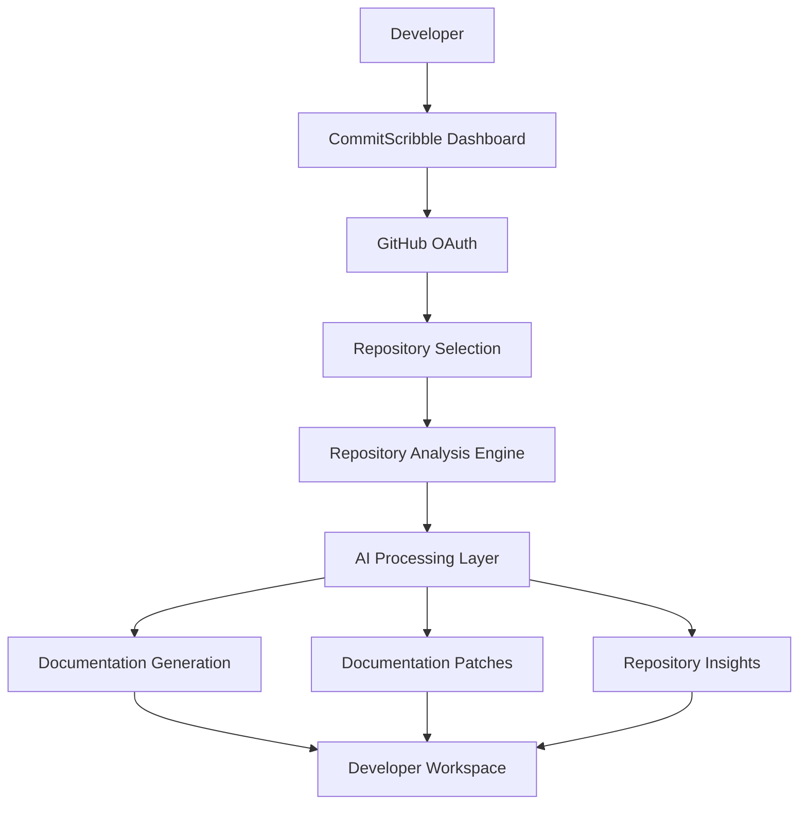

# CommitScribble

### Your AI-Powered GitHub Workflow Assistant

**Automate repository documentation. Understand your codebase. Spend more time building.**

CommitScribble is an AI-powered developer productivity platform designed to simplify GitHub repository management. It connects with your repositories, analyzes project structures, generates meaningful documentation, and helps automate repetitive development workflows — all from one centralized workspace.

[**Live Demo**](https://commitscribble.vercel.app) · 

---

## Project Status


---

## Overview

Managing a software repository involves more than writing code.

Developers frequently spend time understanding unfamiliar codebases, maintaining README files, updating technical documentation, and handling repetitive repository management tasks.

CommitScribble aims to eliminate this friction through AI-powered repository intelligence and automation.

Connect your GitHub account, select a repository, and let CommitScribble help you manage the documentation and workflows surrounding your code.

## Key Features

### 1. GitHub Repository Integration
- Connect your GitHub account.
- Access and manage connected repositories.
- Retrieve repository information and project structure.
- Work with repository data through a centralized interface.

### 2. AI-Powered Repository Analysis
- Analyze repository structures and source files.
- Understand project architecture and dependencies.
- Generate contextual insights about codebases.
- Reduce the time required to understand unfamiliar projects.

### 3. Automated README Generation
- Generate structured README files.
- Create project descriptions and setup instructions.
- Organize technical information into readable documentation.
- Improve repository presentation and consistency.

### 4. Intelligent Documentation Management
- Generate documentation from repository context.
- Identify documentation gaps.
- Create documentation updates and patches.
- Simplify repetitive documentation maintenance.

### 5. Developer Productivity Dashboard
- Centralized repository management.
- Access repository-related activities.
- Organize AI-powered workflows.
- Monitor documentation and automation operations.

### 6. Background Processing
- Asynchronous task execution.
- Background workers for resource-intensive operations.
- Redis-backed job processing infrastructure.
- Improved handling of long-running workflows.

---

## How It Works



**Workflow:**

1. Authenticate using your GitHub account.
2. Connect and select a repository.
3. CommitScribble retrieves relevant repository information.
4. The analysis engine processes the repository context.
5. AI-powered workflows generate documentation and insights.
6. Review and use the generated results.

---

## Technology Stack

| Layer | Technologies |
|---|---|
| Frontend | React, TypeScript, Tailwind CSS |
| Build Tool | Vite |
| State Management | Zustand |
| Backend | Node.js, Express |
| Database | MongoDB |
| Background Jobs | Redis, Worker Services |
| AI Integration | Gemini API |
| Version Control | Git, GitHub API |
| Deployment | Vercel, Backend Hosting |

---

## Architecture

CommitScribble follows a modular architecture designed to separate the user interface, backend services, data persistence, and asynchronous processing.

```text
CommitScribble/
│
├── apps/
│   └── web/                 # Frontend application
│
├── services/
│   ├── api/                 # Backend API
│   └── worker/              # Background processing
│
├── packages/
│   ├── documentation-engine/
│   └── shared/              # Shared utilities and modules
│
├── package.json
├── pnpm-workspace.yaml
└── README.md
```

*The directory structure above represents the intended high-level organization. Adjust it to match the actual repository.*

---

## Getting Started

Follow these instructions to run CommitScribble locally.

### Prerequisites

Make sure you have the following installed:

- Node.js (LTS recommended)
- pnpm
- MongoDB
- Redis
- Git
- GitHub Developer Account
- Gemini API Key

### 1. Clone the Repository

```bash
git clone https://github.com/YOUR_USERNAME/YOUR_REPOSITORY.git

cd CommitScribble
```

### 2. Install Dependencies

```bash
pnpm install
```

### 3. Configure Environment Variables

Create the necessary `.env` files based on the project's `.env.example` files.

Example configuration:

```env
NODE_ENV=development
PORT=5000

API_URL=http://localhost:5000
APP_URL=http://localhost:5173

MONGO_URI=your_mongodb_connection_string
REDIS_URL=your_redis_connection_string

SESSION_SECRET=your_session_secret
TOKEN_ENCRYPTION_KEY=your_encryption_key

GITHUB_CLIENT_ID=your_github_client_id
GITHUB_CLIENT_SECRET=your_github_client_secret
GITHUB_WEBHOOK_SECRET=your_webhook_secret

GEMINI_API_KEY=your_gemini_api_key
```

**Important:** Never commit API keys, OAuth credentials, encryption keys, or other secrets to GitHub.

### 4. Start the Development Environment

```bash
pnpm dev
```

If your workspace uses separate service commands, start the frontend, API, and worker using their respective scripts.

### 5. Open the Application

```text
http://localhost:5173
```

---

## Environment Configuration

| Variable | Description |
|---|---|
| `NODE_ENV` | Application environment |
| `PORT` | Backend server port |
| `MONGO_URI` | MongoDB connection string |
| `REDIS_URL` | Redis connection URL |
| `SESSION_SECRET` | Session signing secret |
| `TOKEN_ENCRYPTION_KEY` | Encryption key for sensitive tokens |
| `GITHUB_CLIENT_ID` | GitHub OAuth application ID |
| `GITHUB_CLIENT_SECRET` | GitHub OAuth application secret |
| `GITHUB_WEBHOOK_SECRET` | GitHub webhook verification secret |
| `GEMINI_API_KEY` | Gemini API authentication key |
| `APP_URL` | Frontend application URL |
| `API_URL` | Backend API URL |

---

## Deployment

CommitScribble is designed to support a distributed deployment architecture.

| Component | Deployment |
|---|---|
| Frontend | Vercel |
| Backend API | Railway / Render |
| Worker | Railway / Render |
| Database | MongoDB |
| Cache and Queue | Redis |

Production deployments require correctly configured environment variables, OAuth callback URLs, CORS settings, database connectivity, and Redis connectivity.

---

## Security Considerations

Security is an important part of repository management.

CommitScribble is designed with the following considerations:

- GitHub OAuth-based authentication.
- Secure handling of authentication credentials.
- Environment-based secret management.
- Token encryption support.
- Protected API endpoints.
- Webhook verification.
- Controlled access to connected repositories.

---

## Roadmap

The following are planned development directions, not necessarily currently released features.

- [ ] Advanced repository intelligence.
- [ ] Automated documentation synchronization.
- [ ] AI-powered codebase summaries.
- [ ] Pull request documentation workflows.
- [ ] More advanced repository analytics.
- [ ] Customizable automation pipelines.
- [ ] Multi-repository workspace management.
- [ ] Team collaboration capabilities.
- [ ] Additional AI model integrations.

---

## Contributing

Contributions, suggestions, and bug reports are welcome.

If you want to contribute:

1. Fork the repository.
2. Create a feature branch.

```bash
git checkout -b feature/your-feature-name
```

3. Commit your changes.

```bash
git commit -m "feat: add your feature"
```

4. Push your branch.

```bash
git push origin feature/your-feature-name
```

5. Open a Pull Request.

Please ensure your changes are tested and follow the existing project conventions.

---

## License

The licensing terms for this project are yet to be finalized. Please check this section before reusing or distributing the source code.

---

## Acknowledgements

Built with modern open-source technologies and AI-powered development tools.

Special thanks to the developer community and everyone contributing to making developer workflows more efficient.

---

## Connect With CommitScribble

**Less repetitive work. More meaningful development.**

[Live Application](https://commitscribble.vercel.app)

**CommitScribble — Built for developers, designed for productivity.**
